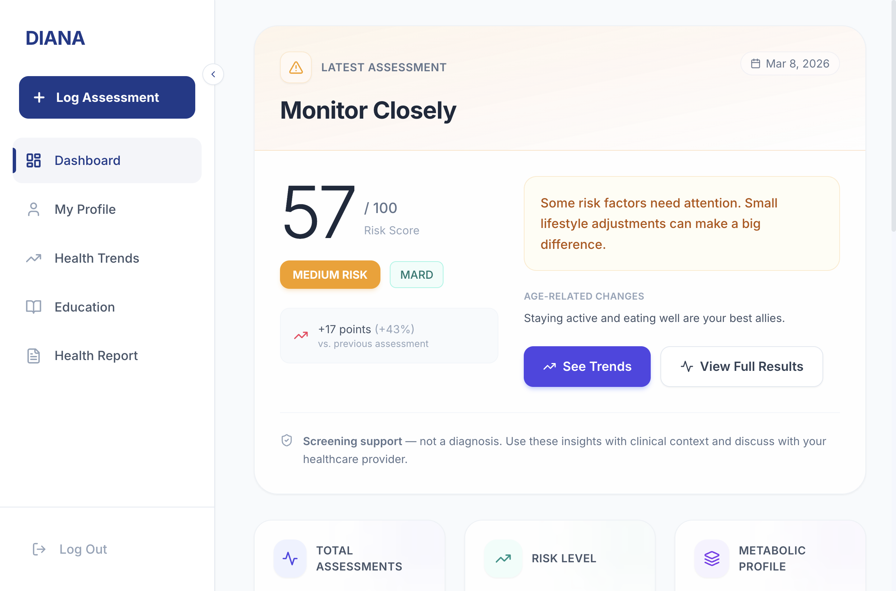
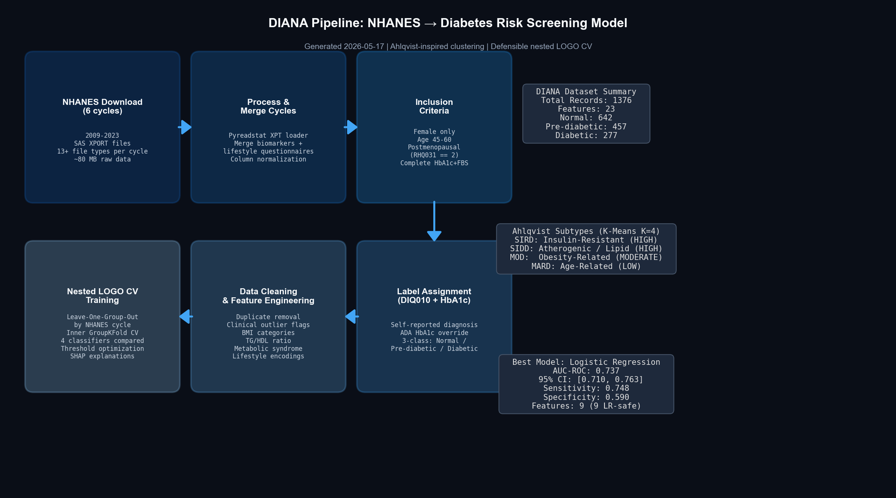
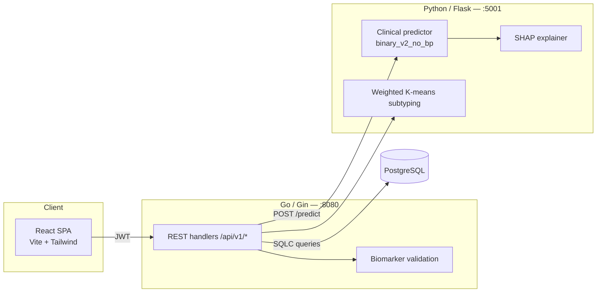

# Diana V2

> **Diabetes risk screening platform for menopausal women** — self-assessment, health trends, and clinician-facing dashboards, backed by a fail-loud data pipeline.

[](https://github.com/Skufu/DianaV2/actions/workflows/ci.yml)
[](https://github.com/Skufu/DianaV2/actions/workflows/cd.yml)
[](https://github.com/Skufu/DianaV2/actions/workflows/security.yml)

[](backend/go.mod)
[](frontend/package.json)
[](Ian_ML/requirements.txt)
[]()

**DianaV2** is a multi-tier medical AI platform. A React single-page app talks to a Go (Gin) API that orchestrates a Python ML service — risk prediction, SHAP explainability, and K-means metabolic subtyping (Ahlqvist: SIRD / SIDD / MOD / MARD) — over PostgreSQL. The training data path follows a lakehouse-lite pattern: a raw-preserving NHANES lake with quality gates, frozen processed snapshots, and versioned model artifacts.



*User dashboard: risk score, metabolic subtype, and assessment history (local dev data).*

## Features

- **Risk screening** — active `binary_v2_no_bp` model (9 non-circular features); clinician accounts are locked to the validated screening model for consistent assessments
- **Explainability** — SHAP feature-contribution waterfall for every assessment
- **Metabolic subtyping** — weighted K-means cluster assignment with personalized recommendations
- **Health trends** — biomarker tracking over time (BMI, lipids, glucose markers) with interactive charts
- **Reports & export** — PDF insights reports and filterable CSV exports
- **Auth & audit** — JWT auth with refresh flow, role-based access control, full audit trail of clinical operations
- **Admin console** — user management, model-run traceability, authentication event logs

*Screening-first: the models provide risk scores for clinical review — not diagnoses. Biomarker inputs are validated against clinical ranges before scoring.*

## Data Architecture (DE)

DianaV2's training data follows a **lakehouse-lite** pattern: a raw-preserving lake with quality gates, frozen processed outputs, and an OLTP system of record. See [docs/06-operations/data-lineage.md](docs/06-operations/data-lineage.md) for the full DAG.



### Storage zones

| Zone | Location | Contents | Mutability |
|---|---|---|---|
| Raw | `data/nhanes/raw/` | NHANES XPT files from CDC (not git-tracked) | Append-only; SHA-256 pinned in `manifest.json` |
| Processed | `data/nhanes/processed/` | Training CSVs (frozen canonical snapshot) | Frozen — regenerate only intentionally |
| Models | `models/binary_v2_no_bp/` | joblib artifacts + model hashes | Regenerated by training |
| System of record | Postgres (NeonDB serverless in prod) | User/assessment data | Live |

### Key commands

```bash
# Regenerate the raw-lake manifest after adding/removing raw files
PYTHONPATH= venv/bin/python scripts/data/generate_nhanes_manifest.py

# Verify the raw lake against the manifest (exit 1 on mismatch)
PYTHONPATH= venv/bin/python scripts/data/download_nhanes_multi.py --verify

# Run all data quality gates (local: full raw checks)
PYTHONPATH= venv/bin/python scripts/data/quality_checks.py

# Run gates in CI mode (raw lake not git-tracked — used by the data-quality job)
PYTHONPATH= venv/bin/python scripts/data/quality_checks.py --skip-raw
```

### Failure semantics

The pipeline **fails loudly** instead of silently degrading:

- `process_nhanes_multi.py` refuses to run (exit 1) when REQUIRED files (`INS` — fasting insulin, `MCQ` — family history) are missing from raw root.
- Combined record count below the `MIN_COMBINED_RECORDS` floor aborts before writing output.
- `quality_checks.py` enforces schema, null-rate, value-range, and row-floor gates on the training CSV; `diana_dataset_imputed.csv` is deliberately **excluded** as a training input (leakage safety).
- CI runs the `data-quality` job (processed CSV gates + manifest freshness); the `docker` build depends on it.

## Tech Stack

| Layer | Technology |
|---|---|
| Backend | Go 1.24+, Gin, SQLC, Goose migrations |
| Frontend | React 18, Vite, Tailwind CSS |
| Database | PostgreSQL 16 (NeonDB serverless in prod) |
| ML | Python 3.10+, Flask, scikit-learn |
| Data | NHANES (CDC) XPT → processed CSV pipeline, SHA-256 manifest gates |
| CI/CD | GitHub Actions: lint/test/build, data-quality, docker, scheduled security |

## System Architecture



**Key decisions:** SQLC for type-safe queries · pluggable HTTP predictor interface (deterministic mock fallback for local dev) · JWT + refresh tokens · audit trail on all clinical operations · backend normalizes all risk semantics — the frontend never recalculates them.

## Repository Layout

| Directory | Purpose |
|---|---|
| `backend/` | Go/Gin REST API — SQLC queries, Goose migrations, JWT + RBAC middleware |
| `frontend/` | React SPA (Vite + Tailwind) — dashboards, assessment forms, trends, admin |
| `Ian_ML/` | Python ML service (Flask) + training pipelines |
| `scripts/` | Data pipeline (`data/`), dev tooling (`dev/`), CI checks (`ci/`) |
| `docs/` | Architecture, guides, ML contracts, operations — start at [docs/README.md](docs/README.md) |
| `data/` | NHANES lake — raw files not git-tracked, processed snapshots versioned |
| `models/` | Versioned model artifacts |

## Quick Start

**Prerequisites:** Go 1.24+, Node 18+, Python 3.10+, PostgreSQL 16 (Docker optional). The setup script can auto-install most tools.

```bash
git clone https://github.com/Skufu/DianaV2.git
cd DianaV2
bash scripts/dev/setup.sh      # deps, env files, database, migrations
bash scripts/dev/start-all.sh  # ML server + backend + frontend
```

Windows: `powershell -ExecutionPolicy Bypass -File scripts/dev/setup.ps1`, then `bash scripts/dev/start-all.sh`.

| Service | URL |
|---|---|
| Frontend | http://localhost:4000 |
| Backend API | http://localhost:8080/api/v1/healthz |
| ML service | http://localhost:5001/health |

> `start-all.sh` runs all three services with live reload and a cleanup trap. Probe health with `GET` — the Gin router 404s `HEAD` requests on GET-only routes. Common `make` targets: `dev`, `seed`, `db_up`, `sqlc`, `lint`, `test`.

## API Overview

**Public:** `GET /api/v1/healthz` · `POST /api/v1/auth/login` · `POST /api/v1/auth/register`

**Protected (JWT):** profile & consent (`/api/v1/users/me/*`), assessments CRUD (`/api/v1/users/me/assessments`), trends (`/api/v1/users/me/trends`), analytics summary.

**Admin (JWT + admin role):** user management, audit logs, model-run history (`/api/v1/admin/*`).

**ML service:** `GET /health` · `POST /predict` · `GET /insights/metrics`. Frontend ML traffic is proxied through the authenticated backend — the ML API key never reaches the browser.

## Configuration

Let `setup.sh` generate the env files, or copy the patterns from `docs/`. Key backend variables:

| Variable | Notes |
|---|---|
| `DB_DSN` | PostgreSQL connection string |
| `JWT_SECRET` | Min 32 chars — `openssl rand -base64 32` |
| `CORS_ORIGINS` | Trusted origins only |
| `MODEL_URL` | ML service endpoint (empty ⇒ mock predictor) |
| `ML_API_KEY` | Shared backend↔ML key (enforced in prod) |
| `MODEL_VERSION` | `binary_v2_no_bp` (validated screening model) |

## Testing & CI

- **Backend:** `make test` (race + coverage) · `make test-contract` for API contract tests
- **Frontend:** `cd frontend && npm test` (Vitest + React Testing Library)
- **ML:** `make test-ml` (pytest)
- **E2E:** Playwright suites are archived and not in CI — see `frontend/e2e/AGENTS.md`
- **CI runs:** lint/test/build for all layers, the **data-quality gates**, a Docker build (depends on data-quality), plus a scheduled security workflow.

## Troubleshooting

| Issue | Fix |
|---|---|
| 401 Unauthorized | Check credentials; run `make seed` for demo users |
| DB connection error | Verify PostgreSQL is running; check `DB_DSN` |
| CORS errors | Add the frontend URL to `CORS_ORIGINS` |
| ML timeout | Verify the ML server is up at `MODEL_URL` |
| Port 5000 conflict | ML defaults to 5001 here — or disable AirPlay Receiver (macOS) |
| ML API 401s | `ML_API_KEY` must match between backend and ML service; never expose it to the browser |

## Security & Medical Notes

> DianaV2 handles health-related data. It is a screening tool, not a diagnostic device.

- **Clinical disclaimer:** risk scores are probabilities for clinician review — not diagnoses. Medical decisions remain with qualified healthcare providers.
- **Auth security:** `JWT_SECRET` is enforced outside `local`/`test`; JWT refresh flow; RBAC; audit logging and auth-event monitoring.
- **Data privacy:** assessment storage with consent tracking; database credentials never in source; production deployments run behind TLS.
- **Vulnerability reporting:** report responsibly to security@diana.app or via [GitHub Security Advisories](https://github.com/Skufu/DianaV2/security/advisories) — please don't open public issues for vulnerabilities.

## Documentation

Start at [docs/README.md](docs/README.md). Canonical docs: [assessment contract](docs/03-ml/assessment-contract.md) · [data lineage](docs/06-operations/data-lineage.md) · [deployment](docs/06-operations/deployment.md) · [methodology](docs/03-ml/methodology.md).

## References & Acknowledgments

| Source | Usage |
|---|---|
| [NHANES](https://wwwn.cdc.gov/nchs/nhanes/default.aspx) — CDC/NCHS, 2009–2023 | Primary training dataset: biomarkers, demographics, lifestyle (postmenopausal women, cycles F–L) |
| American Diabetes Association, *Standards of Care in Diabetes—2024* ([10.2337/dc24-S001](https://doi.org/10.2337/dc24-S001)) | Glycemic status definitions and classification thresholds |
| Ahlqvist et al. (2018), *Lancet Diabetes & Endocrinology* ([10.1016/S2213-8587(18)30051-2](https://doi.org/10.1016/S2213-8587(18)30051-2)) | K-means subtype framework (SIRD / SIDD / MOD / MARD) |
| Lundberg & Lee (2017), NeurIPS | SHAP feature-contribution explainability |
| Van Buuren & Groothuis-Oudshoorn (2011), *JSS* ([10.18637/jss.v045.i03](https://doi.org/10.18637/jss.v045.i03)) | Imputation preserving physiological correlations |
| Vabalas et al. (2019), *PLOS ONE* ([10.1371/journal.pone.0224365](https://doi.org/10.1371/journal.pone.0224365)) | Defensible validation under limited sample size (Leave-One-Cycle-Out) |
| WHO (2021), *Ethics and Governance of AI for Health* | "Screening, not diagnosis" positioning, human-in-the-loop principles |

*Acknowledgments: CDC/NCHS for open NHANES data; the Ahlqvist group for the subtyping framework; scikit-learn for reproducible ML tooling; clinical experts whose interviews informed feature weighting.*

## License

MIT — see [LICENSE](LICENSE).
