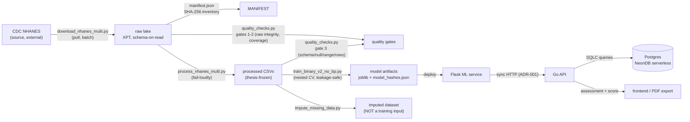

# Data Lineage — DianaV2 NHANES Lake

**Scope:** the training-data side of the platform (NHANES → models).
**Audience:** anyone touching the data pipeline. If you change a stage, update this diagram and the artifact traceability table.

## Pipeline DAG

## Artifact traceability

| Artifact | Producer | Consumer | Integrity check |
|---|---|---|---|
| `data/nhanes/raw/*.XPT` | `download_nhanes_multi.py` (CDC) | `process_nhanes_multi.py`, `quality_checks.py` | `manifest.json` SHA-256; `download_nhanes_multi.py --verify` |
| `data/nhanes/manifest.json` | `generate_nhanes_manifest.py` | `quality_checks.py`, CI `data-quality` job | regenerate after any raw change |
| `data/nhanes/processed/diana_training_data_multi.csv` | `process_nhanes_multi.py` | training, `quality_checks.py` gate 3 | schema, null-rate, range, row-floor |
| `data/nhanes/processed/diana_dataset_imputed.csv` | `impute_missing_data.py` | downstream notebooks **only** | **excluded** from training gates (leakage) |
| `models/binary_v2_no_bp/*.joblib` | `train_binary_v2_no_bp.py` | Flask `DianaPredictor`/`ClinicalPredictor` | `model_hashes.json` (SHA-256) |
| Postgres rows (assessments) | Go API via SQLC | frontend, PDF export | app-level validation (clinical ranges) |

## Lifecycle mapping (Ch 1-2 frame)

| Lifecycle stage | Component |
|---|---|
| Generation | CDC NHANES (external source, XPT + codebooks) |
| Ingestion | `download_nhanes_multi.py` — pull, batch, validated download |
| Storage | raw lake (cold) → processed CSVs (hot) → Postgres (system of record) |
| Transformation | `process_nhanes_multi.py` (merge/clean/derive), imputation |
| Serving | Flask inference → Go API → frontend/PDF; analytics (Spot 2 gap: marts layer pending) |

## Operational notes

- **Raw files are NOT git-tracked** — fetch via downloader, then regenerate the manifest. Processed CSVs ARE tracked.
- **PYTHONPATH poisoning:** the Hermes desktop shell injects its venv site-packages; always run project python with `PYTHONPATH=` cleared:
  `PYTHONPATH= .venv/bin/python scripts/data/...`
- **Required-file rule:** INS/MCQ are REQUIRED (fasting_insulin, family_history_diabetes). Absence = pipeline refuses to run (exit 1) — never WARN-and-continue.
- **Legacy extras:** raw root also contains C/D/E-cycle files (2003–2008) not consumed by the active 2009–2023 spec; they are tracked in the manifest as extra files and are safe to ignore (or archive).
